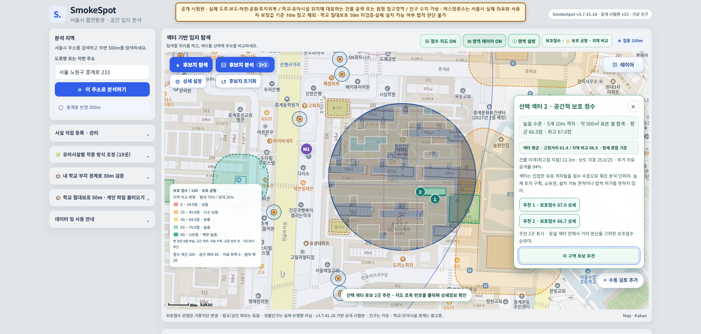
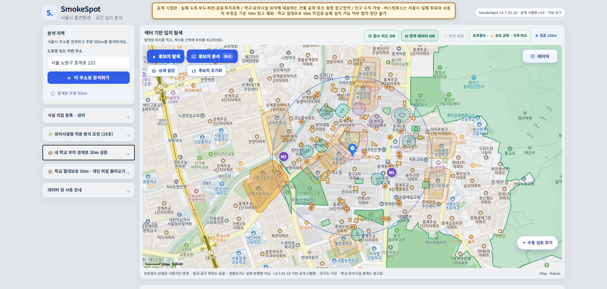

# SmokeSpot

**공공데이터를 활용해 흡연시설의 입지를 비교·검토하는 지도 기반 프로젝트**  
*문제 발견 → 공간정보 기반 시제품 → 현장 조사 → 점수 체계 수정 → 한계를 설명하는 분석 도구*

*중계동 공개 시험판(v15)에서 촬영한 집중 100m 섹터 분석과 추천 후보 1·2. 일부 시설 경계는 실제 위치를 참고하며, 인구 수치는 시연용 가상 자료입니다.*

**[▶ SmokeSpot 중계동 지도 시험판 체험하기](https://neptunus7.github.io/SmokeSpot/preview/)**

> **시연 범위:** 실제 서울 지도와 일부 위치·직접 등록 참고 경계를 이용하지만, **100m 주거인구·250m 생활인구는 가상 수치**입니다. 보호점수는 입지 조건을 비교하기 위한 참고값으로, 실제 설치 가능성·인허가·안전성을 보장하지 않습니다. 전체 로컬 개발 데이터는 공개하지 않았습니다. [데이터 출처 및 공개 범위](docs/DATA_SOURCES.md)

## 1. 왜 시작했나?

흡연자인 프로젝트 기획자 입장에서 흡연할 공간을 찾기 어려운 일이 많았습니다. 그렇다고 흡연 공간이 부족하다는 이유만으로 보행자나 주거지 근처의 길거리 흡연을 정당화할 수는 없었습니다. **흡연자에게 실제로 이용 가능한 공간을 마련하면서, 주변 사람들의 불편과 간접흡연 노출 가능성을 줄일 수 없을까?** 라는 질문에서 출발했습니다.

처음에는 지도에서 적당한 위치 몇 곳을 추천하면 될 것이라고 생각했습니다. 그러나 학교·어린이집·공원 등 보호해야 할 곳, 건물과 보도의 거리, 주변 인구, 자료가 존재하지 않는 지역, 실제 설치 가능성 등을 다루면서 **하나의 점수로 정답을 말할 수 없는 문제**라는 사실을 알게 됐습니다.

SmokeSpot은 설치를 허가하거나 실제 안전성을 보증하는 서비스가 아니라, **후보지를 검토할 때 어떤 근거가 있는지, 어디에 데이터 공백이 있는지, 평가 기준을 바꾸면 결과가 어떻게 달라지는지** 비교하기 위한 실험적 의사결정 지원 도구입니다.

## 2. 어떻게 만들었나? — 개발 방향의 변화

| 단계 | 처음의 접근 | 실제로 바꾼 방향 |
|---|---|---|
| 문제 정의 | 지도에서 흡연시설 후보 위치 찾기 | 흡연자 접근성과 **비흡연자 보호**를 함께 고려하는 입지 문제로 재정의 |
| 초기 탐색 | 중심 반경 500m에서 자동 후보 탐색 | 선택 권역의 상세 평가를 핵심 방식으로 발전시키고, 광역 자동 후보 탐색은 **실험적 보조 기능**으로 유지 |
| 공간 검토 | 학교·공원 등 주변 도형 표시 | 보도·건물·하천·토지피복·주의시설·제외조건을 구분해 판단 |
| 평가 | 추천 순위 하나에 의존 | 건물·보도 거리, 100m 주거인구, 250m 생활인구를 분리하고 **세 가지 관점/사용자 가중치**를 비교 |
| 검증 | 지도 수치가 곧 객관적 평가라는 가정 | 현장 M1·M2와 데이터 공개율 비교를 통해 **결측과 점수의 한계**를 확인 |
| 결과 전달 | 점수 높은 후보 표시 | 후보의 근거, 주의사항, 근접 감점, 자료 미산정을 **설명할 수 있도록** 개선 |

단계별 버전 기록은 [전체 개발 연혁](docs/DEVELOPMENT_HISTORY.md), 판단이 바뀐 이유는 [핵심 실험·의사결정](docs/DECISIONS_AND_EXPERIMENTS.md)에 정리했습니다. 일부 오래된 버전 기록은 과거 HTML과 문서를 토대로 **사후 복원**했으며, 과거 Git 커밋이 존재하는 것처럼 작성하지 않았습니다.

## 3. 로컬판에서 실제로 구현·검증한 것

최신 확인된 로컬판: **v3.7.41.18**. 아래 내용은 해당 로컬판의 기능이며 **이 공개 데모가 모두 제공한다는 뜻이 아닙니다.**

- 카카오 지도 위 건물·보도·차도·하천·학교·어린이집·놀이터·공원 등 공간 조건과 주의시설 표시
- 선택 영역/섹터의 공간 분석, 보호점수 지도, 정밀 후보 비교 및 저장 조사지점 검토
- 건물 거리·보도 거리·SGIS 주거인구·서울시 생활인구를 이용한 **보호점수** 구성
- **보호 균형 / 건물·보행 이격 / 인구 노출 회피** 세 관점 및 총합 100점 사용자 가중치
- **고정거리 평가 / 지역 비교 반영**의 민감도 비교, 보호시설 경계 바깥 10m까지 최대 10점의 **자체 참고 감점** (법적 기준 아님)
- 주거인구 자료의 충족률 80%와 50% 실험, 미공개·미확인 인구를 **0명으로 대체하지 않는 처리**
- 상가 인근 흡연 장소(M1)와 아파트 옆 공터(M2)의 현장 검토 지점을 기록·평가하는 기능

사용자가 실제 PC에서 감점 ON/OFF, 사용자 설정, 영역 설명, 점수 상세, 저장 기록 유지를 확인했습니다. 이 확인은 **현장 안전성이나 인허가 적합성의 실증 검증을 의미하지 않습니다.** [기능 및 확인 범위](docs/VALIDATION.md)

## 4. 핵심 실험에서 알게 된 점

**M1과 M2는 점수의 한계를 드러낸 계기였습니다.** 로컬판에서 M1은 주거인구 참조 격자 충족률이 약 89%, M2는 약 56%로 관찰됐습니다(당시 실험 조건). 80% 기준에서는 M2를 평가할 수 없었고, 50% 기준으로 낮추면 비교가 가능했습니다. 하지만 **점수가 산출됐다는 사실은 데이터가 완전하다는 뜻이 아닙니다.** 그래서 공개율 기준을 바꾸는 실험을 별도 표시하고, '미산정'을 0점으로 취급하지 않았습니다.

또한 주변 인구가 적다고 높은 보호점수를 받는 위치가 흡연자에게 접근하기 쉽거나 설치하기 좋은 곳인지는 별개의 문제입니다. 실제 수요, 부지 소유·허가, 시설 유형, 출입구·환기구, 현장 보행 동선은 앞으로 더 검토해야 합니다. [현장 사례 및 판단 변화](docs/DECISIONS_AND_EXPERIMENTS.md)

## 5. 데이터 공개 범위와 유의사항

중계동 공개 시험판에는 실제 위치를 참고한 공간정보와 사용자가 그린 시설 경계가 일부 포함됩니다. 반면 인구 수치는 가상이며, 로컬 개발 환경에서 사용한 전체 원본 공간정보·통계 데이터는 공개하지 않았습니다.

**데이터를 사용하거나 출처를 표기할 수 있다는 사실이 원본·가공 좌표의 공개 재배포까지 자동으로 허용한다는 뜻은 아닙니다.** 공개 파일별 저작권·이용조건·지도 캡처 관련 조건은 추가 확인이 필요합니다. [출처와 공개 범위](docs/DATA_SOURCES.md) · [로컬과 공개본의 차이](docs/LOCAL_VS_PUBLIC.md) · [공개 범위를 결정한 배경](docs/PUBLICATION_DECISION.md)

## 6. 대표 웹 데모 — 집중 100m 권역 분석

- **집중 100m — 핵심 상세 평가:** 선택한 권역의 격자·섹터별 공간 조건과 보호점수를 검토하고, 해당 권역의 후보지를 비교하는 방식
- **광역 500m — 실험적 보조 탐색:** 넓은 범위에서 자동으로 잠재 후보지를 표시해 탐색 결과를 살펴보는 초기 방식. 지도에 후보 번호가 나타나는 것은 이 모드의 기능이며, **최종 설치 장소를 확정하거나 추천한다는 뜻은 아닙니다.**

두 방식은 **서로 다른 탐색 모드**로 제공되며, 광역 탐색 결과가 집중 평가로 자동 연결되는 구조는 아닙니다. 광역 자동 탐색은 개발 과정과 방식별 차이를 살펴보기 위한 실험 기능으로 유지하고, 현재의 주된 입지 검토는 집중 100m 권역 평가를 중심으로 설명합니다.

**현장조사 기록:** M1·M2 핀과 조사 메모는 당시 작성자 브라우저에 저장된 개인 기록입니다. 다른 방문자의 브라우저에 자동으로 나타나지는 않습니다.

*보호시설 참고 경계와 M1·M2 조사 지점을 표시한 실제 촬영 화면. 지도·공간 경계의 일부는 실제 위치 기반이며 인구는 가상입니다.*

개발 초기의 독립 합성 데모와 테스트 파일은 **개발 기록으로 저장소에 보존**했습니다. 공개 데모 간 차이와 테스트 범위는 [로컬과 공개본 비교](docs/LOCAL_VS_PUBLIC.md) 및 [검증 범위](docs/VALIDATION.md)에서 설명합니다.

## 7. 버전별 개발 기록

현재 저장소의 첫 커밋이 곧 개발 시작 시점인 것은 아닙니다. **2026년 10월부터 별도 로컬 파일로 개발한 이력**을 확인 가능한 범위에서 문서로 복원했습니다.

- **v0.8~v0.9:** 학교·공원 표시, 500m 탐색, 놀이터 경계 수동 등록
- **v1~v2:** 인구·토지피복·보도·하천·후보지 검토 기능 확장
- **v3.3~v3.6:** 학교 자료 재검토, 비교표, 관점별 평가, 수동 조사 지점 저장, 지도 중심 UI
- **v3.7.0~v3.7.16:** 점수 계산 근거 시각화, 자동·저장 후보 평가와 오류 개선
- **v3.7.2x~v3.7.41:** 선택 영역/섹터 분석, 주거인구 공개율·M1/M2 실험, 점수 구성 개편
- **v3.7.41.18:** 세 관점 사용자 설정 기준선·초기화, 근접 감점, 최종 UI 및 PC 기능 점검

자세한 이력과 확인 상태: [DEVELOPMENT_HISTORY.md](docs/DEVELOPMENT_HISTORY.md)  
공개 데모 자체 변경 내역: [CHANGELOG.md](CHANGELOG.md)

## 8. 앞으로의 개발 방향 (Roadmap)

SmokeSpot의 다음 목표는 **후보를 더 많이 추천하는 것**보다, **추천의 근거를 검증하고 실제 설치 가능한 공간과 구분하는 것**입니다. 아래 항목은 **계획·검토 단계이며 현재 구현·검증 완료 기능이 아닙니다.** 일정과 구현 순서는 데이터 확보 및 검증 결과에 따라 달라질 수 있습니다.

### 1. 데이터 신뢰도 — 실제 인구 데이터 연계와 결측 처리

현재 공개 지도 시험판의 **가상 인구**를 실제로 활용 가능한 자료로 대체할 수 있는지 검토합니다. 100m 주거인구·250m 생활인구의 기준 시점, 시간대, 집계 방식, 공개율·누락값, 사용·재배포 조건을 확인합니다. 확보하지 못한 자료는 **0명으로 간주하지 않고 미확인으로 표시**합니다.

### 2. 보행자 보호 — 예상 통학동선 반영

학교 경계·출입구 주변 보호 기준을 유지하면서 주거지역과 학교를 연결하는 **추정 도보 동선**을 추가 검토합니다. 예상 최단 경로는 실제 학생들의 통학로와 다르므로, 공식 통학로·현장 자료 등으로 검증하기 전에는 참고 지표로만 사용합니다.

### 3. 설치 가능성 — 입지 점수와 실제 실행 가능성 분리

점수가 높은 장소라도 건물·출입구·보도 폭·통행 방해·부지 소유·관리 주체·현행 규정 때문에 설치가 어려울 수 있습니다. 지도상 검토와 현장 확인, 관계기관 협의가 필요한 조건을 **별도 체크리스트**로 분리합니다.

### 4. 평가 검증 — 현장조사와 점수 체계 교차검증

M1·M2처럼 이미 관찰한 장소와 추천 후보를 같은 조건에서 비교하고, 가중치·평가 반경·인구 자료 공개율에 따라 순위가 얼마나 달라지는지 기록합니다. 점수를 결과에 맞게 조정하는 대신 **변화 이유와 모델의 한계**를 설명하도록 개선합니다.

### 5. 실사용 검토 — 수요·주민 수용성과 제안 대상별 협의

담배꽁초, 거리 흡연, 실제 이용 접근성, 주민 의견과 운영·관리 비용을 관찰·검토하여 **설치 필요성**을 점수와 별도로 판단합니다. 제안 대상의 구분은 아래 장기 목표에서 다룹니다.

### 6. 시설 유형별 검토 — 흡연구역 종류와 운영 방식 비교

개방형 지정 구역, 흡연부스, 기존 흡연공간 개선 등 가능한 방식을 후보지 특성과 비교합니다. 면적, 통행·출입구 간섭, 환기, 화재·안전, 설치·유지관리 비용, 관련 규정 등을 확인합니다. 현장 조사와 관리주체 협의 전에는 유형별 설치 적합성을 확정하지 않습니다.

### 7. 장기 확장 — 지역 데이터 통합과 맞춤형 제안서

지역별 공간·보행·보호시설·인구·민원·현장 관찰 데이터를 **출처와 신뢰도별로 구분해 통합**합니다. 이를 바탕으로 후보지별 검토 근거와 확인되지 않은 사항을 정리하는 제안서 기능을 구상합니다.

### 장기 목표: 설치 주체에 맞는 제안 방식 구분

SmokeSpot을 지자체 전용 서비스에 한정하지 않고, **입지별 소유·관리 주체와 설치·운영 책임을 확인한 뒤 제안 대상을 구분하는 시스템**으로 확장하고자 합니다. 아래는 미래에 검토할 활용 시나리오이며, 실제 권한이나 허가 가능성이 확인됐다는 의미는 아닙니다.

- **지자체·공공기관:** 공공 관리 장소의 흡연시설 신설·이전·개선 검토. *추가 확인:* 부지 관리 권한, 금연구역 등 관련 규정, 주민 의견, 예산과 운영 책임.
- **공동주택 관리주체(아파트):** 단지 내 기존 흡연공간의 위치·관리 방식 개선 검토. *추가 확인:* 단지 규약·의사결정 절차, 주민 수용성, 보행·출입구·환기 영향.
- **민간 건물 소유자·관리자:** 건물 부지 내 흡연시설 설치·재배치 가능성 검토. *추가 확인:* 소유·사용 권한, 출입구·환기구, 통행과 소방·안전 조건.
- **상가·상권 관리주체:** 주변 점포가 함께 이용할 수 있는 흡연공간 운영 방안 검토. *추가 확인:* 부지 권한, 운영비 부담 주체, 이용 수요, 인근 보행자와 주민의 영향.

제안서에는 **후보지 지도, 보호시설과의 관계, 접근성, 검증된 수요·현장조사 기록, 적합한 시설 유형의 대안, 데이터 공백, 필요한 협의 사항**을 함께 담는 방향을 검토합니다. 공공데이터·현장 관찰·가상 수치는 분리하고, 실제 수요나 법적 설치 가능성을 확인하지 못한 항목은 미확인으로 남깁니다.

**개발 원칙:** 비흡연자 보호를 우선하되 흡연자의 실제 이용 가능성을 함께 평가합니다. 실제 공간자료와 가상·추정 수치를 명확히 구분하며, **점수는 추천 근거이지 설치 허가나 안전 판정이 아닙니다.**

## 9. 남은 질문

높은 보호점수와 실제 이용·설치 가능성이 일치하지 않을 때 어떻게 판단할지, 자료가 부족한 지역을 어떻게 표시할지가 다음 검증 과제입니다. [다음 실험](docs/NEXT_QUESTIONS.md) · [모델 한계](docs/SCORE_LIMITATIONS.md)

---

**제작·작업 방식:** 문제 정의, 조사 방향, 조건 설계, 화면 검토와 실사용 검증은 프로젝트 기획자가 수행하고, AI 도구를 코드 작성·수정과 자료 검토, 문서 초안에 활용했습니다. 코드가 만들어진 것과 현장에서 검증된 사실은 구분해 기록했습니다.  
**라이선스:** 제3자 데이터 이용조건과 본 프로젝트 소스 코드 라이선스는 별개입니다. 이 저장소의 자체 소스 라이선스는 아직 별도로 지정하지 않았습니다.
