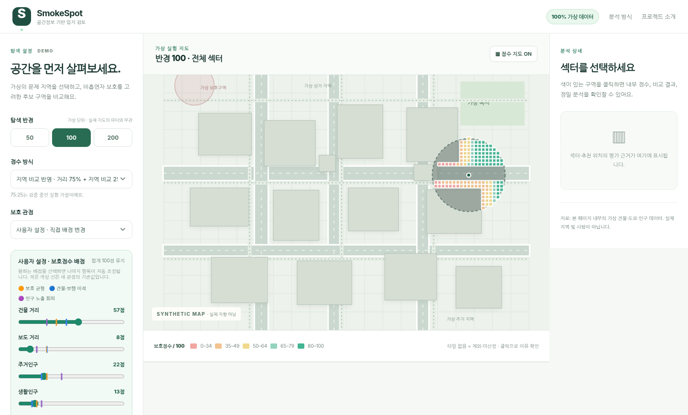

# SmokeSpot

**공공데이터를 활용해 흡연시설의 입지를 비교·검토하는 지도 기반 프로젝트**  
*문제 발견 → 공간정보 기반 시제품 → 현장 조사 → 점수 체계 수정 → 한계를 설명하는 분석 도구*

> **공개 안내**: 이 저장소에서 실행되는 웹은 **가상 도형·가상 인구로 만든 독립적인 공개 데모**입니다. 실제 중계동을 대상으로 개발한 최신 로컬판은 **v3.7.41.18(2026-11-14)**이며, 실제 도형·인구·현장 기록이 포함된 통합 파일은 이 저장소에 공개하지 않았습니다. 두 버전은 사용 데이터와 기능 범위가 다릅니다.

## 1. 왜 시작했나?

흡연자인 프로젝트 기획자 입장에서 흡연할 공간을 찾기 어려운 일이 많았습니다. 그렇다고 흡연 공간이 부족하다는 이유만으로 보행자나 주거지 근처의 길거리 흡연을 정당화할 수는 없었습니다. **흡연자에게 실제로 이용 가능한 공간을 마련하면서, 주변 사람들의 불편과 간접흡연 노출 가능성을 줄일 수 없을까?** 라는 질문에서 출발했습니다.

처음에는 지도에서 적당한 위치 몇 곳을 추천하면 될 것이라고 생각했습니다. 그러나 학교·어린이집·공원 등 보호해야 할 곳, 건물과 보도의 거리, 주변 인구, 자료가 존재하지 않는 지역, 실제 설치 가능성 등을 다루면서 **하나의 점수로 정답을 말할 수 없는 문제**라는 사실을 알게 됐습니다.

SmokeSpot은 설치를 허가하거나 실제 안전성을 보증하는 서비스가 아니라, **후보지를 검토할 때 어떤 근거가 있는지, 어디에 데이터 공백이 있는지, 평가 기준을 바꾸면 결과가 어떻게 달라지는지** 비교하기 위한 실험적 의사결정 지원 도구입니다.

## 2. 어떻게 만들었나? — 개발 방향의 변화

| 단계 | 처음의 접근 | 실제로 바꾼 방향 |
|---|---|---|
| 문제 정의 | 지도에서 흡연시설 후보 위치 찾기 | 흡연자 접근성과 **비흡연자 보호**를 함께 고려하는 입지 문제로 재정의 |
| 초기 탐색 | 중심 반경 500m에서 자동 후보 탐색 | 사용자가 **50·100·200m 영역 또는 다각형을 선택**하고 영역/섹터를 평가하는 방식으로 변화 |
| 공간 검토 | 학교·공원 등 주변 도형 표시 | 보도·건물·하천·토지피복·주의시설·제외조건을 구분해 판단 |
| 평가 | 추천 순위 하나에 의존 | 건물·보도 거리, 100m 주거인구, 250m 생활인구를 분리하고 **세 가지 관점/사용자 가중치**를 비교 |
| 검증 | 지도 수치가 곧 객관적 평가라는 가정 | 현장 M1·M2와 데이터 공개율 비교를 통해 **결측과 점수의 한계**를 확인 |
| 결과 전달 | 점수 높은 후보 표시 | 후보의 근거, 주의사항, 근접 감점, 자료 미산정을 **설명할 수 있도록** 개선 |

단계별 버전 기록은 [전체 개발 연혁](docs/DEVELOPMENT_HISTORY.md), 판단이 바뀐 이유는 [핵심 실험·의사결정](docs/DECISIONS_AND_EXPERIMENTS.md)에 정리했습니다. 일부 오래된 버전 기록은 과거 HTML과 문서를 토대로 **사후 복원**했으며, 과거 Git 커밋이 존재하는 것처럼 작성하지 않았습니다.

## 3. 로컬판에서 실제로 구현·검증한 것

최신 확인된 로컬판: **v3.7.41.18**. 아래 내용은 해당 로컬판의 기능이며 **이 공개 데모가 모두 제공한다는 뜻이 아닙니다.**

- 카카오 지도 위 건물·보도·차도·하천·학교·어린이집·놀이터·공원 등 공간 조건과 주의시설 표시
- 선택 영역/섹터의 공간 분석, 보호점수 지도, 정밀 후보 비교 및 저장 조사지점 검토
- 건물 거리·보도 거리·SGIS 주거인구·서울시 생활인구를 이용한 **보호점수** 구성
- **보호 균형 / 건물·보행 이격 / 인구 노출 회피** 세 관점 및 총합 100점 사용자 가중치
- **고정거리 평가 / 지역 비교 반영**의 민감도 비교, 보호시설 경계 바깥 10m까지 최대 10점의 **자체 참고 감점** (법적 기준 아님)
- 주거인구 자료의 충족률 80%와 50% 실험, 미공개·미확인 인구를 **0명으로 대체하지 않는 처리**
- 상가 인근 흡연 장소(M1)와 아파트 옆 공터(M2)의 현장 검토 지점을 기록·평가하는 기능

사용자가 실제 PC에서 감점 ON/OFF, 사용자 설정, 영역 설명, 점수 상세, 저장 기록 유지를 확인했습니다. 이 확인은 **현장 안전성이나 인허가 적합성의 실증 검증을 의미하지 않습니다.** [기능 및 확인 범위](docs/VALIDATION.md)

## 4. 핵심 실험에서 알게 된 점

**M1과 M2는 점수의 한계를 드러낸 계기였습니다.** 로컬판에서 M1은 주거인구 참조 격자 충족률이 약 89%, M2는 약 56%로 관찰됐습니다(당시 실험 조건). 80% 기준에서는 M2를 평가할 수 없었고, 50% 기준으로 낮추면 비교가 가능했습니다. 하지만 **점수가 산출됐다는 사실은 데이터가 완전하다는 뜻이 아닙니다.** 그래서 공개율 기준을 바꾸는 실험을 별도 표시하고, '미산정'을 0점으로 취급하지 않았습니다.

또한 주변 인구가 적다고 높은 보호점수를 받는 위치가 흡연자에게 접근하기 쉽거나 설치하기 좋은 곳인지는 별개의 문제입니다. 실제 수요, 부지 소유·허가, 시설 유형, 출입구·환기구, 현장 보행 동선은 앞으로 더 검토해야 합니다. [현장 사례 및 판단 변화](docs/DECISIONS_AND_EXPERIMENTS.md)

## 5. 왜 최신 실데이터 개발본을 그대로 공개하지 않았나?

**개발한 것이 없어서가 아니라, 실제 데이터가 포함된 통합 소스의 공개 범위를 확인할 수 없기 때문입니다.** 로컬 HTML 자체에도 일부 실제 공간 도형 좌표가 포함되어 있어 외부 GeoJSON만 삭제한다고 완전히 분리되지 않습니다. 데이터 사용 가능 여부, **원본 또는 가공 좌표의 재배포 가능 여부**, 지도 API·통계 자료의 별도 조건은 서로 다를 수 있습니다.

일부 기관의 **출처 표기 후 이용 가능 안내**는 있었지만, 그것만으로 모든 실제 지형·격자 파일을 누구나 내려받을 수 있는 GitHub 저장소에 올려도 된다고 확정할 수는 없습니다. **공간정보품질관리원 문의는 2026-11-14 기준 회신을 받지 못했습니다.** 미회신을 허가 또는 위반 판정으로 해석하지 않고, 불확실한 실데이터 포함 파일의 공개를 예방적으로 보류했습니다.

그래서 **실제 데이터 없이도 점수·섹터 평가 아이디어를 시험할 수 있는 별도 가상 데모**를 만들었습니다. 로컬 원본은 보존하고, 공개 저장소에는 가상 도형·가상 인구·설명 문서·테스트만 올립니다. 이것은 **실제 로컬판 전체 소스를 공개한 것과 다릅니다.** [데이터 출처·공개 원칙](docs/DATA_SOURCES.md) · [로컬과 공개본 비교](docs/LOCAL_VS_PUBLIC.md) · [공개 결정 배경](docs/PUBLICATION_DECISION.md)

## 6. 지금 실행할 수 있는 공개 데모

> 공개 데모는 가상 데이터만 사용합니다. 좌표 단위는 실제 미터가 아니며, 실제 학교·인구·시설의 평가 결과를 보여주지 않습니다.

- 가상 영역 선택, 공간 충돌 제외, 보호점수별 섹터 탐색
- **보호 균형 / 건물·보행 이격 / 인구 노출 회피** 관점, 배점 합계 100점 사용자 설정
- **고정거리 평가 / 지역 비교 반영** 비교와 가상 보호시설 근접 감점 ON/OFF
- 섹터 정밀 분석과 후보 **0·1·2곳**의 비교

**실행:** GitHub Pages가 활성화된 저장소라면 Pages 링크로 접속합니다. 로컬에서는 이 폴더에서 `python -m http.server 8000`을 실행하고 `http://localhost:8000`에 접속할 수 있습니다. **테스트:** Node.js 18+에서 `npm test` (`npm install` 불필요). Pages 공개 URL은 실제 설정·배포를 검증한 후 추가합니다.

## 7. 버전별 개발 기록

현재 저장소의 첫 커밋이 곧 개발 시작 시점인 것은 아닙니다. **2026년 10월부터 별도 로컬 파일로 개발한 이력**을 확인 가능한 범위에서 문서로 복원했습니다.

- **v0.8~v0.9:** 학교·공원 표시, 500m 탐색, 놀이터 경계 수동 등록
- **v1~v2:** 인구·토지피복·보도·하천·후보지 검토 기능 확장
- **v3.3~v3.6:** 학교 자료 재검토, 비교표, 관점별 평가, 수동 조사 지점 저장, 지도 중심 UI
- **v3.7.0~v3.7.16:** 점수 계산 근거 시각화, 자동·저장 후보 평가와 오류 개선
- **v3.7.2x~v3.7.41:** 선택 영역/섹터 분석, 주거인구 공개율·M1/M2 실험, 점수 구성 개편
- **v3.7.41.18:** 세 관점 사용자 설정 기준선·초기화, 근접 감점, 최종 UI 및 PC 기능 점검

자세한 이력과 확인 상태: [DEVELOPMENT_HISTORY.md](docs/DEVELOPMENT_HISTORY.md)  
공개 데모 자체 변경 내역: [CHANGELOG.md](CHANGELOG.md)

## 8. 남은 질문과 다음 단계

이 프로젝트의 현재 점수는 **비흡연자 보호에 관한 대리지표**를 중심으로 한 탐색용 기준입니다. 실제 간접흡연량, 흡연자 수요, 설치 적법성을 측정하지 않습니다. 앞으로의 핵심 질문은 **보호점수가 높지만 이용하기 어려운 곳을 어떻게 구분할 것인가**, 그리고 **데이터가 불충분한 지역을 어떻게 표현할 것인가**입니다.

구체적인 다음 실험과 미해결 질문: [NEXT_QUESTIONS.md](docs/NEXT_QUESTIONS.md) · [모델 한계](docs/SCORE_LIMITATIONS.md)

---

**제작·작업 방식:** 문제 정의, 조사 방향, 조건 설계, 화면 검토와 실사용 검증은 프로젝트 기획자가 수행하고, AI 도구를 코드 작성·수정과 자료 검토, 문서 초안에 활용했습니다. 코드가 만들어진 것과 현장에서 검증된 사실은 구분해 기록했습니다.  
**라이선스:** 제3자 데이터 이용조건과 본 프로젝트 소스 코드 라이선스는 별개입니다. 이 저장소의 자체 소스 라이선스는 아직 별도로 지정하지 않았습니다.
